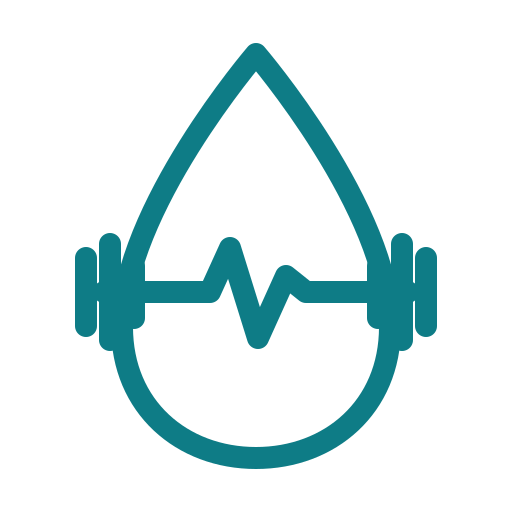
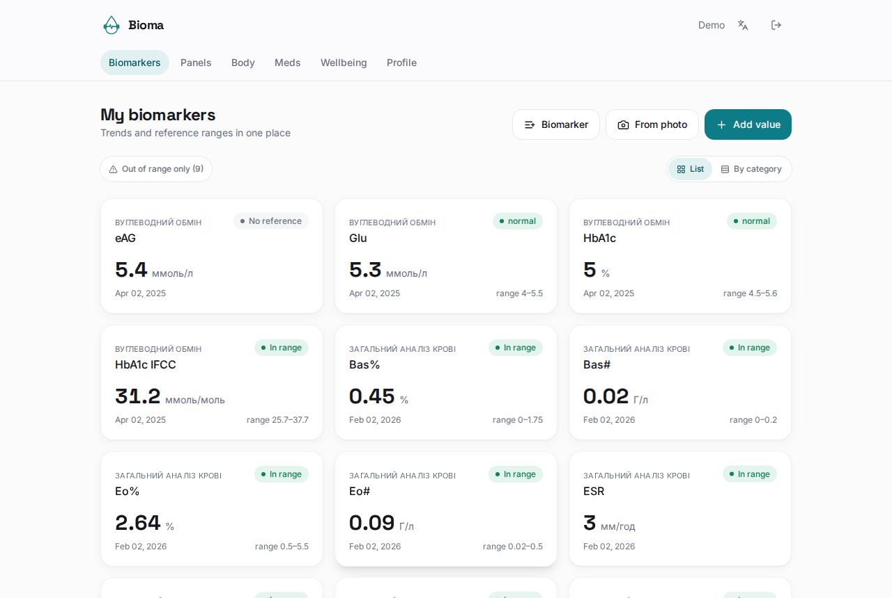
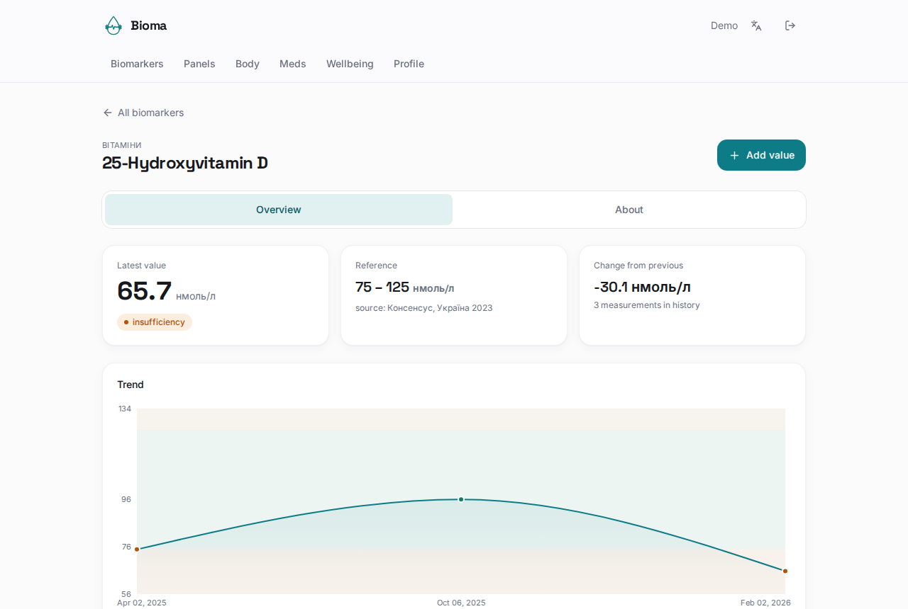
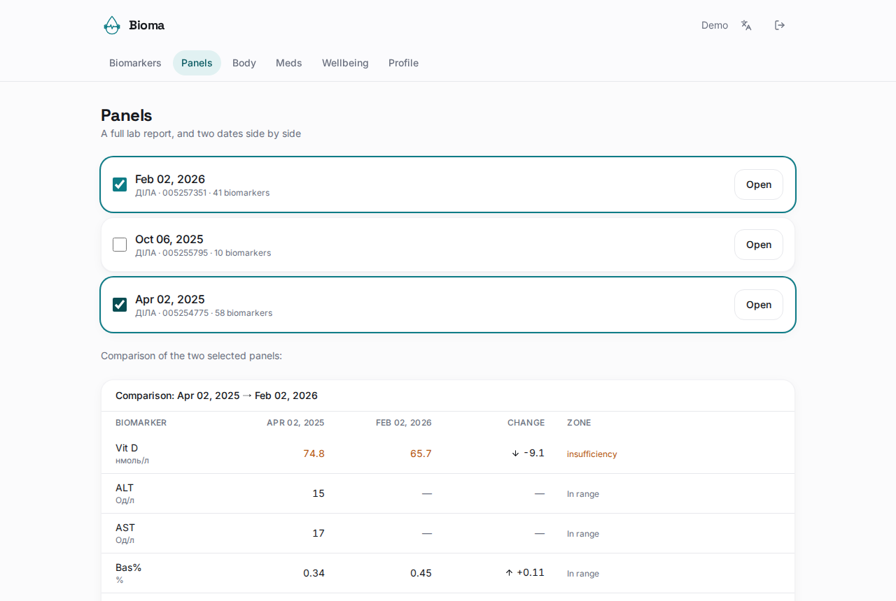
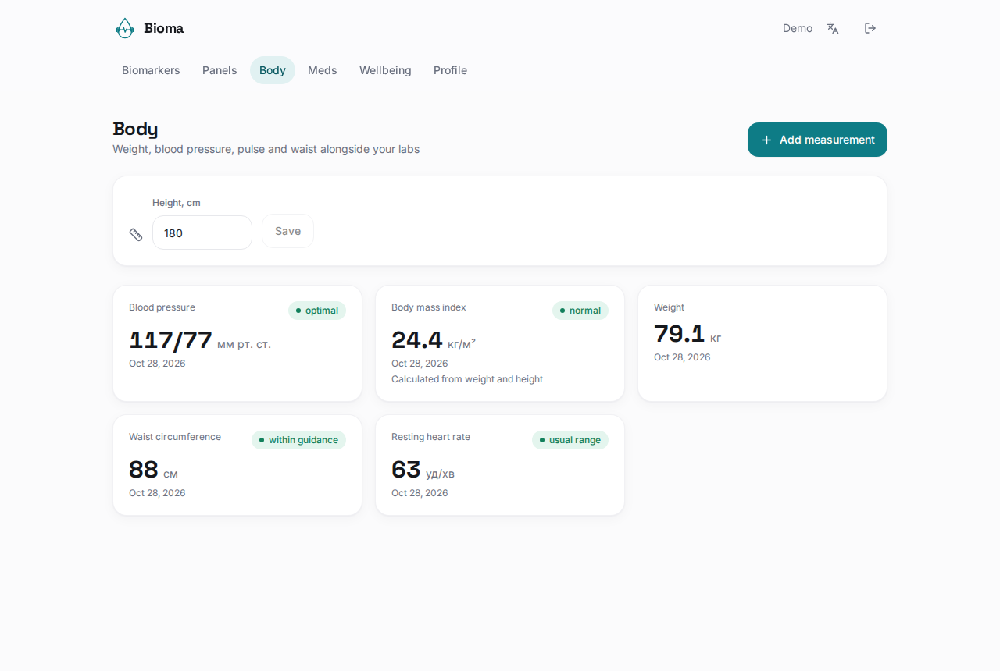
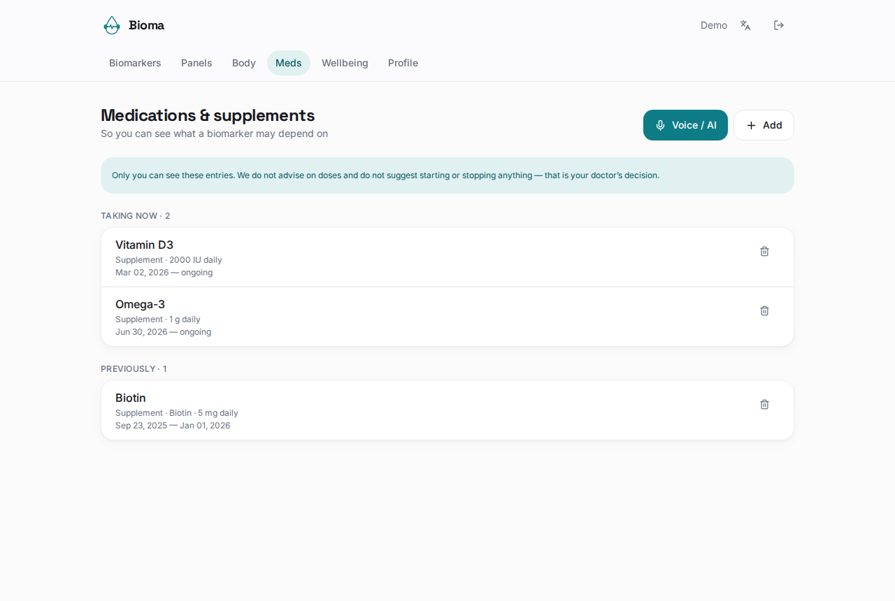
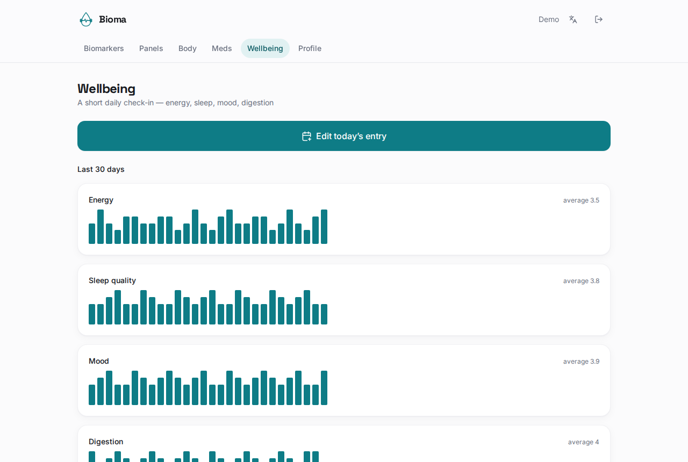
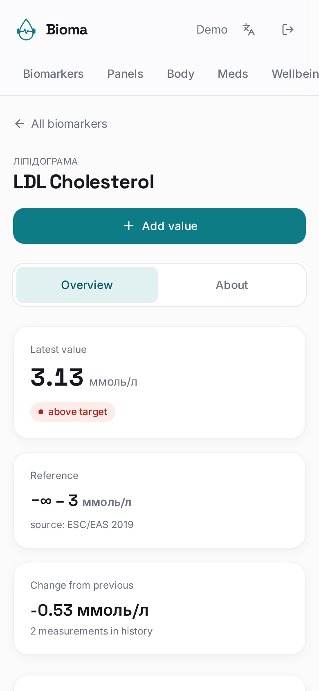
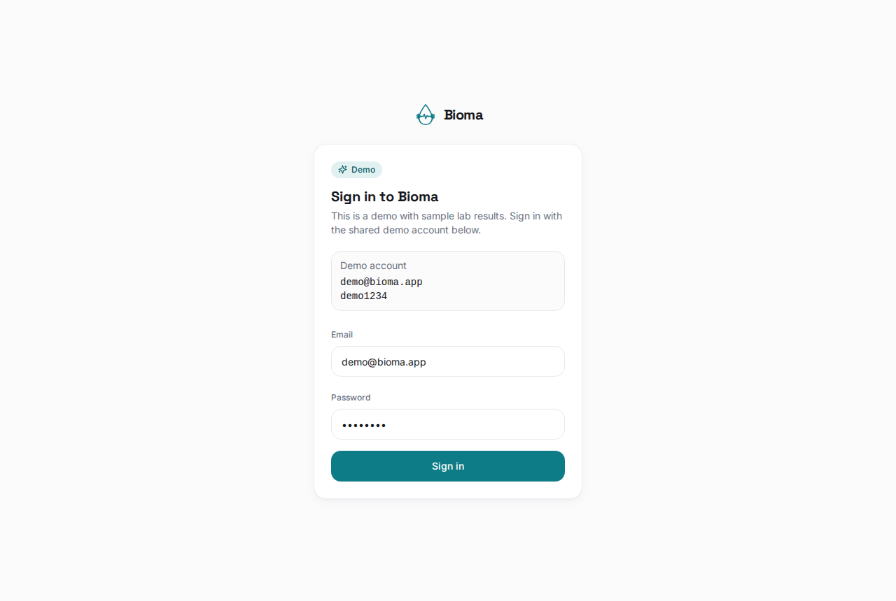

<p align="center">
  
</p>

<h1 align="center">Bioma</h1>

<p align="center">
  <b>All your lab results in one place: clear, over time, and easy to understand.</b>
</p>

<p align="center">
  
</p>

---

## What is Bioma?

Most of us get blood tests a few times a year, from different labs, on paper or
as PDFs. The results end up scattered across email, photos and drawers. Then a
doctor asks *"how has your vitamin D changed since last year?"* and nobody knows.

**Bioma is a personal health notebook for your lab results.** You add your
results by hand, or just snap a photo of the lab report, and Bioma:

- keeps the **full history** of every marker (vitamin D, cholesterol, TSH, ferritin…),
- shows whether each value is **in range, low or high**, taking your age and sex into account,
- draws a **trend chart** so you can see where things are heading,
- lets you **compare two lab visits** side by side.

It's designed to be calm and readable, without medical jargon or alarming red walls.

> ⚕️ Bioma is for information only and isn't medical advice. Always discuss
> your results with a doctor.

---

## A quick tour

### Every marker, at a glance
Your dashboard shows the latest value of every marker you track, with a coloured
badge: in range, low or high. You can filter to show only what's out of range, or
group markers by category (blood count, lipids, thyroid…).

### See the trend, not just the number
Open any marker to see all your past values on one chart. The green band is the
normal range, so you can tell straight away whether you're heading in or out
of it. An **About** tab explains in plain language what the marker means and
what can affect it.

<p align="center"></p>

### Compare two lab visits
Pick any two lab reports and Bioma lines them up: what went up, what went down,
and which zone each value is in now.

<p align="center"></p>

### Add results from a photo
Take a picture or upload a PDF of your lab report. AI reads the values and
matches them to the right markers. **You review everything before it's saved.**
Nothing goes into your history without your confirmation.
*(This feature needs an AI key; see "Try it yourself" below.)*

### More than lab tests

| | |
|---|---|
| **Body**: weight, waist, blood pressure, resting pulse, plus BMI calculated for you. |  |
| **Medications & supplements**: keep a list of what you take and when, so you can see what might affect a marker. You can also just say it out loud, and AI fills in the form for you to check. |  |
| **Wellbeing**: a 10-second daily check-in on energy, sleep, mood and digestion, with 30-day trends. |  |

Also included:
- 🔔 **Retest reminders** for markers you want to check regularly.
- 🔁 **Unit conversion**: results from labs that use different units still line up on one chart.
- 🌸 **Cycle tracking** for female profiles, with phases and gentle estimates.
- 🌐 **Ukrainian and English** interface.
- 📱 **Works on your phone** and can be installed like an app. Your saved data stays viewable even offline.

<p align="center"></p>

---

## Try it yourself (demo)

The easiest way is the built-in **demo mode**. It comes with a sample patient's
anonymised results from three lab visits, plus a few weeks of wellbeing and
body data.

<p align="center"></p>

**Demo login**

| Email | Password |
|-------|----------|
| `demo@bioma.app` | `demo1234` |

The sign-in page also shows these and fills them in for you.

### Run it on your computer

You only need [Docker Desktop](https://www.docker.com/products/docker-desktop/).
Download this project, open a terminal in its folder and run:

```bash
docker compose up --build
```

The first run takes a few minutes. When the log shows `Bioma API → http://localhost:3001/api`, open
**http://localhost:8080** and sign in with the demo account above.

- To stop it, press `Ctrl+C`.
- To reset the demo data, run `docker compose down -v` and then start again.
- **Optional:** to try the AI features (reading lab reports from photos, adding medications by voice), create a file called
  `.env` next to `docker-compose.yml` with `ANTHROPIC_API_KEY=your-key` before
  starting. Everything else works without it.

> The demo account is shared. Don't put real personal health data into a public demo.

---

## Privacy by design

- Your results are visible **only to you**: every request is checked against your account.
- AI suggestions are always **reviewed by you** before they're saved.
- Signing out also clears the copy of your data saved on the device.
- Bioma doesn't give dosing advice or tell you to start or stop anything. That's your doctor's call.

---

## For developers

Bioma is a React + NestJS + PostgreSQL app with AI document recognition.
Architecture, local setup, environment variables, the API and the full
demo-mode reference are in **[docs/DEVELOPMENT.md](docs/DEVELOPMENT.md)** (in Ukrainian).
